# xtune client

The app for [xtune](https://github.com/chethober/xtune) servers, on **Android, Linux and Windows**.

- **Connect**: paste or scan your subscription link and tap once (refresh or remove it from Home). Auto mode uses the config that works best on the
  network you are on, and switches to the next when one is blocked: across every kind the server runs, not only Xray
  (REALITY, XHTTP, VLESS Encryption, Hysteria2, Shadowsocks-2022, WireGuard, Trojan, CDN and Worker relays,
  AmneziaWG, SSH over TLS or a CDN, and the DNS tunnel as a last resort). OpenVPN, IKEv2 and the Telegram proxy open
  in the apps made for them.
- **Check**: test every config from your own device and network: does it answer, how fast, does it get throttled
  after a few seconds. Results go back to the server (if you allow it), so everyone on your network gets the working
  configs first.
- **Manage**: for whoever runs the server: users with quotas and expiry, their links and QR codes, the server's
  configs and which networks block them, **tuning from your phone** (the server starts test configs, your phone
  measures them on your network, the best are deployed), updates, logs, and a console for any `xtune` command.
  Over SSH; the server's host key is pinned on first use.
- Whole-device VPN or a local proxy (SOCKS `127.0.0.1:10808`, HTTP `127.0.0.1:10809`), domestic sites direct, ad
  blocking, your own routing rules, per-app exclusions on Android, an app lock, a leak test, and English and Persian.

## Screenshots

<p align="center">
  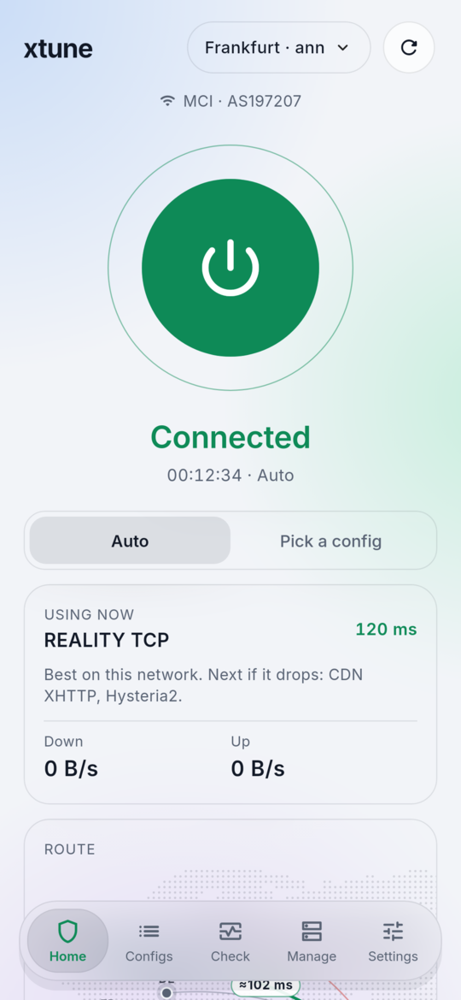
  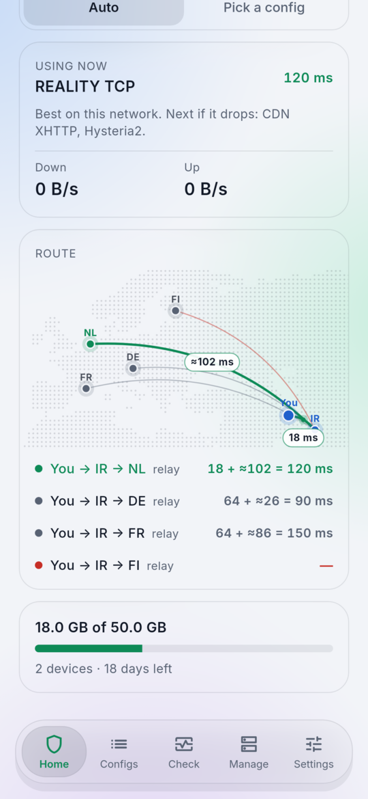
  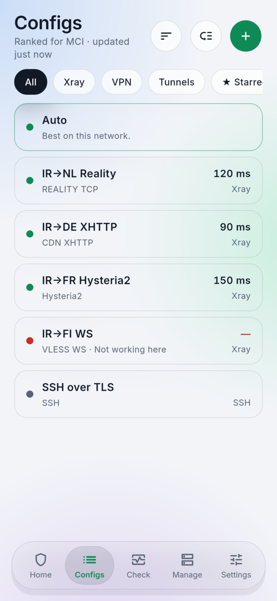
</p>
<p align="center">
  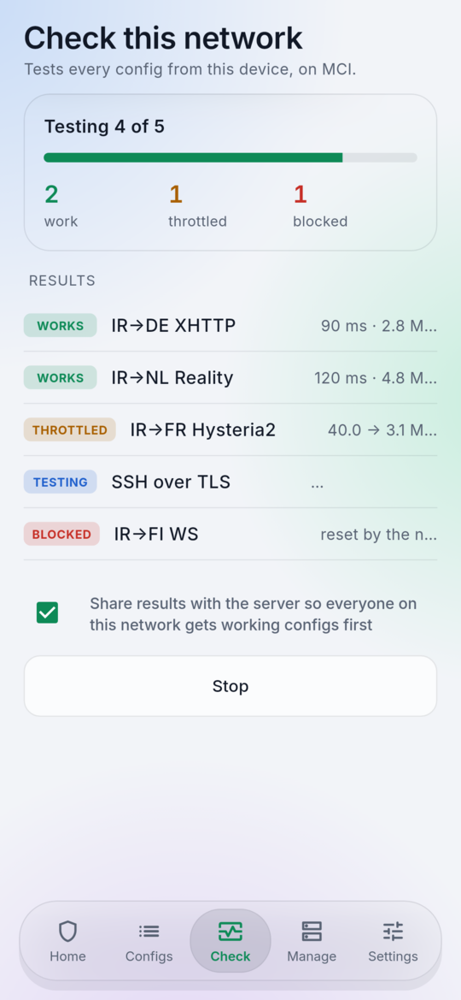
  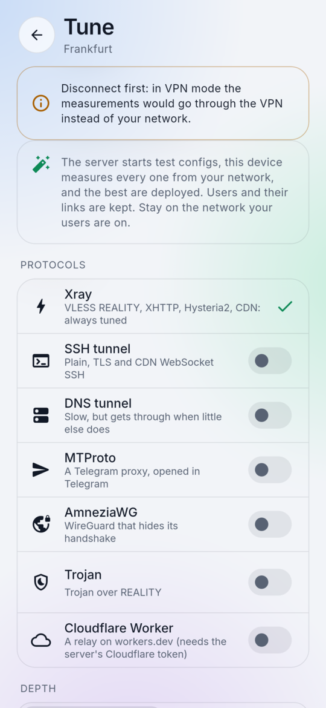
  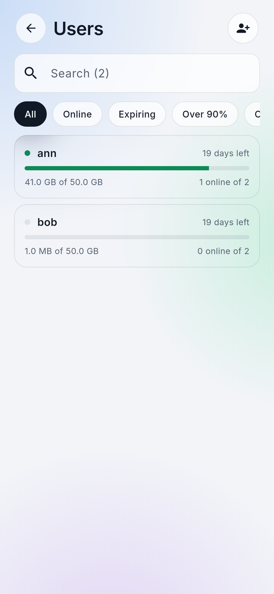
</p>
<p align="center">
  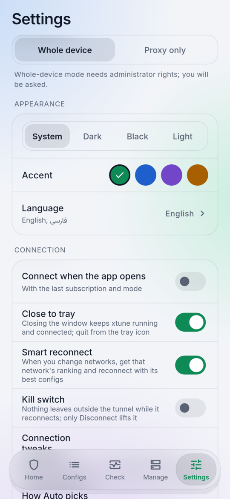
  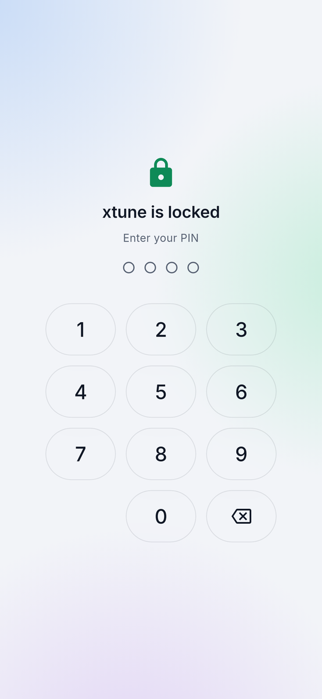
  
</p>

On a wide window every tab has the same frame: a column, and a pane beside it.

<p align="center">
  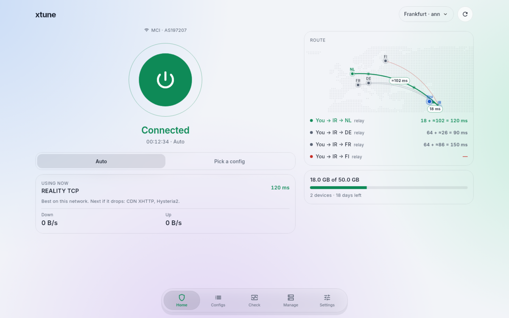
</p>
<p align="center">
  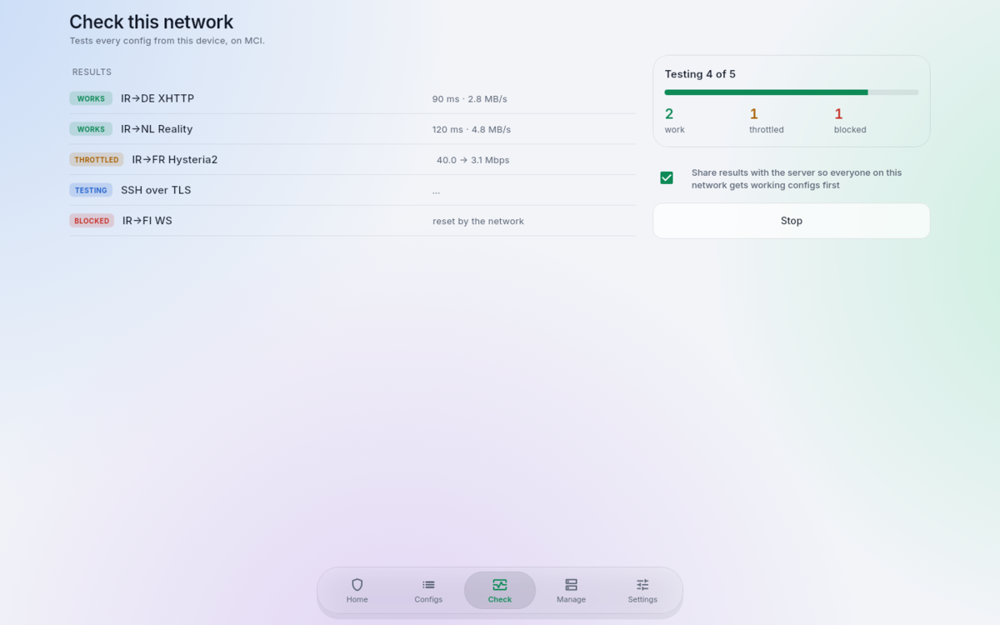
  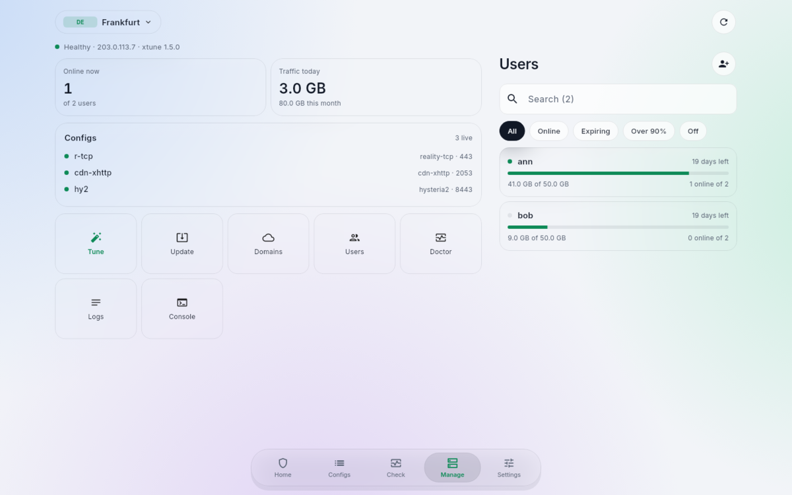
</p>

## Install

From [Releases](https://github.com/chethober/xtune/releases):

- **Android**: `xtune-…-android-arm64-v8a.apk` for almost every phone (`armeabi-v7a` for old ones). Allow installing
  from your browser or file manager when asked.
- **Linux**: unpack `xtune-…-linux-x64.tar.gz` and run `./install.sh` (or just `./xtune`). Whole-device mode asks for
  your password through polkit; proxy mode needs nothing.
- **Windows**: unzip `xtune-…-windows-x64.zip` anywhere and run `xtune.exe`. Whole-device mode asks for
  administrator rights.

`SHA256SUMS` lists every file's checksum.

## How it works

```
Flutter UI (app/)  ──  Android: gomobile library in the app · desktop: xtune-core on a local port
                        │
Go core (core/) ──  Xray is the router for everything: a TUN or SOCKS/HTTP inbound, one balancer over
                    every config. SSH, the DNS tunnel and AmneziaWG run in-process behind local SOCKS
                    ports, so Xray health-checks and fails over across all of them alike.
```

The core imports the CLI's own packages from this repository (`cli/pkg`: protocols, tunnel, state, remote),
so the app connects exactly the way xtune measures. The server serves each user a profile at `…/TOKEN/client` (every config
with what the app needs to connect, ordered for the app's network) and takes check results at `…/TOKEN/report`.
Servers older than that still work: the app falls back to the subscription's failover config (Xray configs only).

## Build

Needs Go and Flutter 3.50. Run these from `app/`; the core builds against `../cli`.

```sh
scripts/fetch-geo.sh core/testdata/geo && (cd core && go test ./...)   # the core, with end-to-end tests
scripts/build-desktop.sh linux                                        # or windows, on Windows
scripts/build-android-core.sh && (cd app && flutter build apk --split-per-abi)
```

`go run ./cmd/devsub` (in `core/`) serves a fake subscription backed by a local Xray server, for working on the app
without a server: add `http://127.0.0.1:18080/p/tok`. `app/integration_test` drives the real app against it.
`SHOTS=1 flutter test --update-goldens test/v15_test.dart` (in `app/`) renders the screenshots above into
`test/shots/`.

## License

MIT. The core includes [Xray-core](https://github.com/XTLS/Xray-core) (MPL-2.0),
[amneziawg-go](https://github.com/amnezia-vpn/amneziawg-go) (MIT), [dnstt](https://www.bamsoftware.com/software/dnstt/)
(CC0); Windows builds include [Wintun](https://www.wintun.net/) (see `wintun-LICENSE.txt`).
